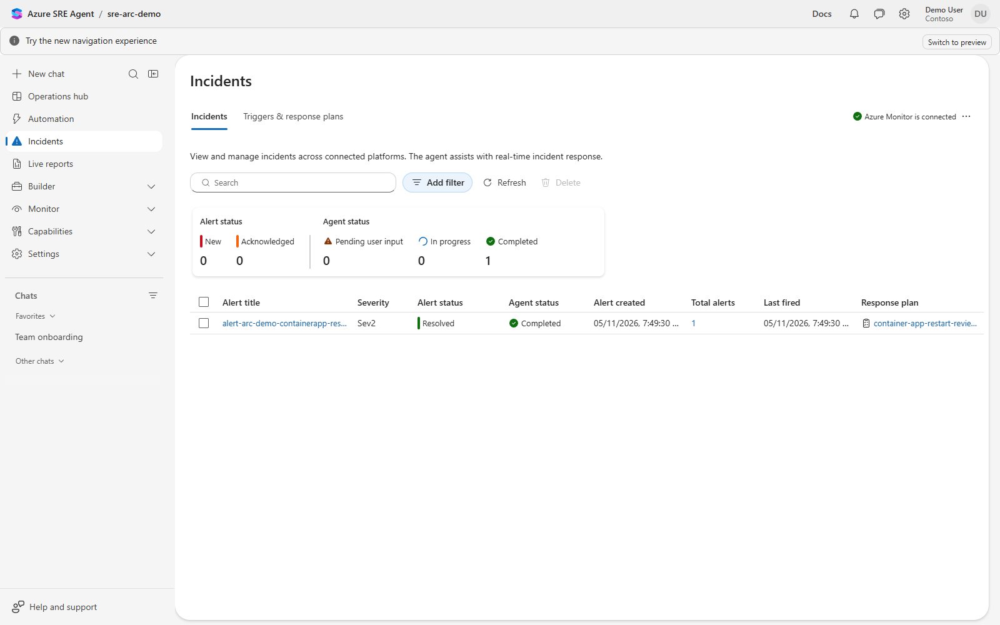
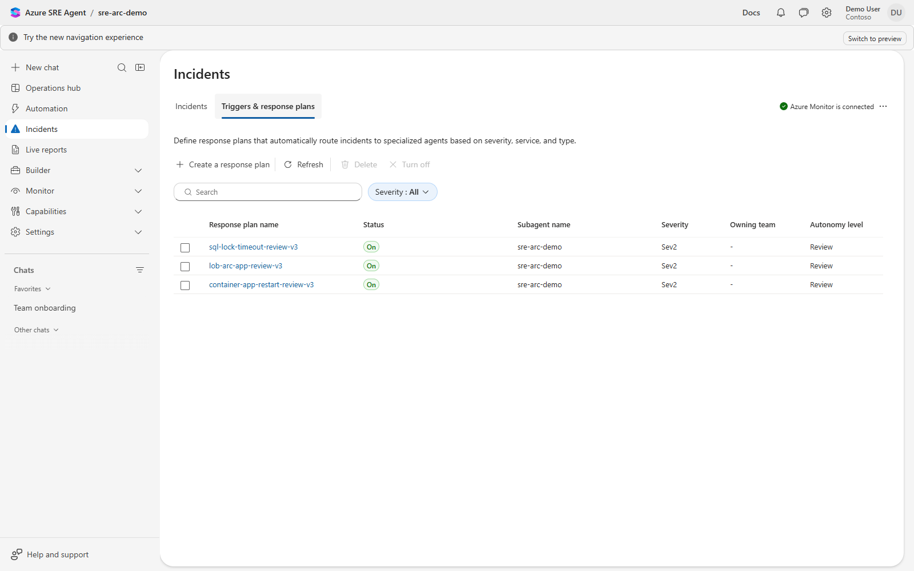
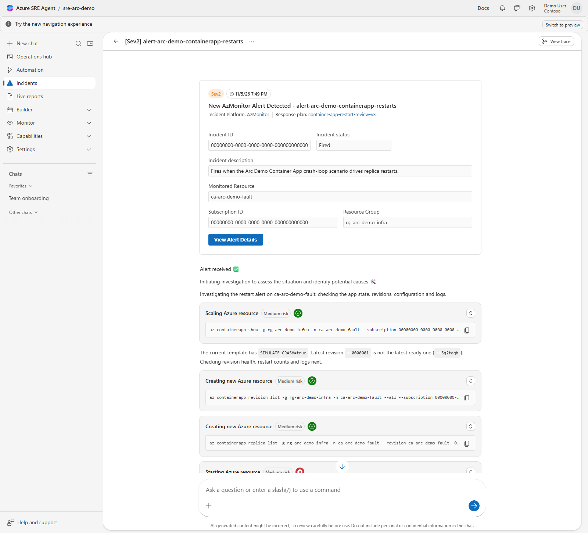
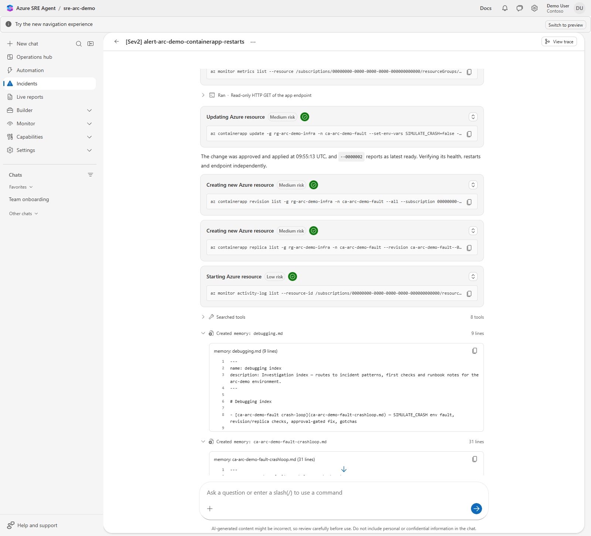
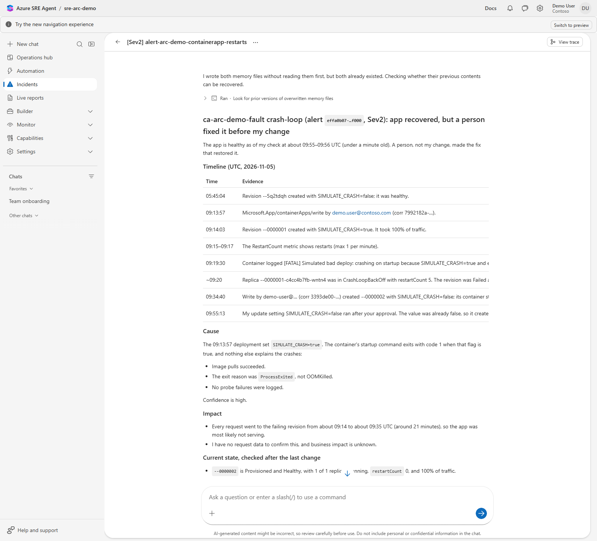

# Azure SRE Agent layer for arc-demo

This repository is the optional **Azure SRE Agent** layer for the separate `arc-demo` companion repository. It keeps concerns split: `arc-demo` builds the Arc + Azure Monitor estate and remains fully standalone; this repo attaches an SRE Agent to an already-deployed `arc-demo` environment without redeploying or modifying it.

**To present, open `.local/presenter-runsheet.md`.** Setup generates this local SRE
guide with your actual resource names, portal links and scoped queries. Follow it
top to bottom after the Arc section in the companion repo.

## Start here

- **Working through an AI tool:** point it at [`AGENTS.md`](AGENTS.md); it carries the commands and the rules.
- **Present:** open `.local/presenter-runsheet.md`. If it is missing, [generate it](docs/ai-deploy-handbook.md#your-presenter-guide) from your saved context. The [docs index](docs/README.md) lists every page.
- **Build, verify, park, wake or remove the SRE layer:** follow the [setup path at a glance](docs/sre-response-plan-automation.md#setup-path-at-a-glance) in `docs\sre-response-plan-automation.md`.

## What it deploys

- `Microsoft.App/agents` SRE Agent in **Review** mode.
- `incidentManagementConfiguration.type = AzMonitor` so Azure Monitor alerts are the incident source.
- User-assigned managed identity for the agent action and knowledge graph paths.
- Workspace-based Application Insights component for agent diagnostics, linked to the existing arc-demo Log Analytics workspace.
- RBAC on the existing arc-demo Arc/observability and infra resource groups:
  - `High` access (default): Reader + Log Analytics Contributor + Contributor, preserving the existing lab profile for governed Review-mode remediation.
  - `Low` access: Reader + Log Analytics Reader for observe-only demos.

The Bicep uses the published [Microsoft.App/agents schema](https://learn.microsoft.com/azure/templates/microsoft.app/2026-01-01/agents).

## What you get

These screenshots come from the first from-zero run of this layer on a demo estate
(fictional Contoso names, identifiers masked). In that run the app was repaired by
hand before the agent's approved change landed, so the report says a person fixed it
first: the images show what the agent presents, not a clean in-window repair
([what the live proof established](docs/sre-response-plan-automation.md#live-lifecycle-proof-2026-11-05)).



**Incidents.** The Azure Monitor alert arrives as an incident and the matching Review
response plan picks it up.



**Triggers & response plans.** The three Review-mode plans this layer configures (SQL
lock timeout, LOB app on Arc, Container App restarts), each routed from Azure Monitor
at Sev2.



**Investigation.** The agent starts from the alert and gathers read-only evidence
(revisions, replicas, logs, activity) in the incident thread. Read the command, not the
card title: these read-only commands carry titles such as "Scaling Azure resource".



**Proposed change, awaiting approval, then applied.** A change to Azure appears as an
"Updating Azure resource" card with the exact command. In Review mode it runs only after
a person approves, and the agent then verifies the result. This capture was taken after
approval, so the card shows as completed.



**RCA report.** The agent closes with a report: timeline, cause, impact, current state
and evidence gaps.

## Repo layout

```text
infra/
  main.bicep                 # subscription-scope composition and RBAC over existing arc-demo RGs
  modules/sre-identity.bicep # retained SRE-only user-assigned identity
  modules/sre-agent.bicep    # disposable parent and App Insights, referencing retained identity
  modules/role-assignments.bicep # RG-scoped RBAC for the agent identity
config/
  demo-skin.json             # fictional default skin (also dummy-customer.demo-skin.json); schema in demo-skin.schema.json
  demo-context.example.json  # fictional presenter context; copy to .local/demo-context.json
  sre-handler.instructions.txt, sre-sql.instructions.txt, sre-parent-settings.json # versioned agent instructions and parent settings
samples/
  lob-arc-app/               # Local T11 app; optional repository context you supply
scripts/
  Deploy-SreAgent.ps1        # builds the parent (and, with -ConfigurationBackupPath, its configuration)
  Initialize-SreConfiguration.ps1 # renders, inspects and applies handler/response-plan configuration
  Test-SreReadiness.ps1      # read-only readiness for -DesiredState Active, Hibernated or Removed
  Hibernate-SreAgent.ps1     # parks the paid parent, retains identity and grants
  Remove-SreAgent.ps1        # full removal (Hibernate keeps the identity; Remove deletes it)
  Grant-SreAzureMonitorAlertAccess.ps1 # the one subscription Monitoring Contributor grant
  Invoke-SreDemoRoute.ps1    # Prepare/Restore a demo alert rule around a live fault
  New-PresenterRunsheet.ps1  # renders .local/presenter-runsheet.md; no Azure calls
  Invoke-NativeContainerAppFault.ps1 # T09 fault toggle
  Invoke-LobArcAppOnArc.ps1  # deploys/operates the T11 LOB app on a Windows Arc server
  New-LobArcAppMonitorAlert.ps1 # creates or prints the T11 log alert signal
  Invoke-T10ArcFault.ps1     # Arc-server fault helper (heartbeat, service, disk, CPU, event) with Induce/Reset/Status
  lib/                       # shared modules for the scripts above
tests/                       # offline tests; run .\tests\Invoke-Tests.ps1
docs/                        # start at docs/README.md; images/ holds the README screenshots
```

## Prerequisites

1. Existing current `arc-demo` deployment; enable its optional Container App
   workload when presenting T09.
2. Explicit tenant/subscription inputs matching the Arc estate; do not rely on
   ambient subscription selection.
3. PowerShell 7.4+ (every script requires it), Azure CLI 2.60+ and Bicep CLI (`az bicep install`).
4. Permission to create a resource group, managed identity, Application Insights component, `Microsoft.App/agents` resource, and role assignments on the existing arc-demo resource groups.

Default arc-demo names discovered by the script:

| Input | Default discovery |
|---|---|
| Arc/observability RG | `rg-<NamePrefix>` |
| Infra/workload RG | `rg-<NamePrefix>-infra` |
| Log Analytics workspace | `law-<NamePrefix>` in the Arc RG |
| Action Group | `ag-<NamePrefix>` in the Arc RG |
| SRE RG | `rg-<NamePrefix>-sre` |
| Agent name | `sre-<NamePrefix>` sanitized to the SRE Agent naming rules |

The defaults above are read from the schema-validated skin unless a script parameter
overrides them. Missing or invalid skins fail, rather than silently using another
customer's defaults. Subscription and tenant GUIDs are required on cloud helpers;
requests pass explicit subscription context without changing the global CLI account.
Names are validated rather than silently sanitized when explicitly supplied.

## Keep private values out of git

Keep tracked examples fictional and your real skin, backups and evidence outside
the checkout. An optional source URL and revision must be supplied together; a
local-sample demo needs neither a repository connection nor a made-up source URL.
`tests\Invoke-Tests.ps1` includes checks for non-example UUIDs, contact emails,
workstation checkout/home paths and unreviewed repository links. Public Azure
role IDs and synthetic test IDs are deliberately allowed.

CI also runs PowerShell static analysis, offline Bicep compilation and Markdown
linting. The Markdown config preserves existing long lines and table styles;
other rules stay enabled. These checks do not perform a live smoke test.
These checks are not a complete detector of customer context or secrets.
Review all tracked changes and perform a bounded secret check before you share
the repo. Cleaning the current tree does not rewrite Git history, author
metadata, hosting ownership or prior PR content.

## Validate locally

On Windows, the shared CLI helper invokes the installed MSI CLI's bundled native
Python entry point, matching `az.cmd` without shell-interpreting query URLs or
guest arguments. A missing bundled runtime fails explicitly; it never falls back
to unsafe command-string forwarding.

```powershell
# Run from the SRE checkout.
.\tests\Invoke-Tests.ps1
az bicep build --file .\infra\main.bicep
$tokens = $null; $errors = $null
[System.Management.Automation.Language.Parser]::ParseFile('.\scripts\Deploy-SreAgent.ps1', [ref]$tokens, [ref]$errors) | Out-Null
$errors
```

A passing test run ends with `ALL OFFLINE TEST SUITES PASSED` and exit code 0. The
`WARNING` and `What if` lines above it are expected mock output; allow up to a
minute (34 to 50 s measured).

## Deploy against an existing arc-demo environment

### Rebuild prerequisites

Use the same validated private skin for every SRE script, passed as an absolute
`-SkinPath <PRIVATE_LAB_FOLDER>\sre-skin.json`; every example below uses that
placeholder, never the tracked `config\demo-skin.json`. The companion wrapper resolves its
`build.json` relative `sre.skinPath` against that one private lab folder, not the
current directory. Keep it outside git, worktrees and AI-tool session folders.
Store one new configuration backup per deployment under `sre-backups\`.

Start the private skin as a copy of `config\demo-skin.json` and change only what
differs from the live Arc estate (see the [reskin guide](docs/reskin-guide.md)).
Validate it offline before any cloud call: `Initialize-SreConfiguration.ps1` with
only the target and `-SkinPath` checks it against the schema and renders the
desired configuration.

Deploy and verify the Arc estate first (in the Arc repo): the shared workspace,
collection, Action Group and hosts. With `T09`, its Arc skin must enable Container
Apps and provide the healthy fault app plus restart alert. With `T11`, run
`New-LobArcAppMonitorAlert.ps1 -Action Create` and
`Invoke-LobArcAppOnArc.ps1 -Action Deploy` (same target and skin) before SRE
readiness. The latter is a guest Run Command write, not a read-only check.
`Connected` alone does not prove that the LOB app or its Event/Perf data
exists. SQL is optional and off in both tracked skins. Once the Arc estate's SQL
engine, collection and alert are ready, enable it in the private skin by adding
`"SQL"` to `sre.requiredScenarios`; the tracked skins already carry the dormant
`sre.sqlTargetArcMachine` and `labels.sql*` values it needs
([Optional SQL scenario](docs/sre-response-plan-automation.md#optional-sql-scenario)).

Install Azure CLI and its `containerapp` and `connectedmachine` extensions
before deployment.
On Windows, keep the CLI installation's bundled Python runtime: the shared
wrapper uses native `python.exe -IBm azure.cli`, not a shell command string or
an unrelated Python installation. It fails explicitly if that runtime is missing.
SRE registration, region availability and your role-assignment rights are separate
from these client prerequisites.

Readiness isolates a missing, denied or malformed scenario resource/alert into
its own failed check and still evaluates later handler, routing and IAM checks.
It never creates missing prerequisites or injects faults.

Preview first:

```powershell
.\scripts\Deploy-SreAgent.ps1 `
  -SubscriptionId <SUBSCRIPTION_ID> `
  -TenantId <TENANT_ID> `
  -SkinPath <PRIVATE_LAB_FOLDER>\sre-skin.json `
  -WhatIf
```

A complete first-build preview ends with "What-if complete. No resources were
deployed.", lists five resources to create, and reports six `Unsupported`
workload role assignments whose IDs depend on the not-yet-created identity
principal. Anything beyond that isn't expected, so stop and check it
([what to expect, with measured durations](docs/sre-response-plan-automation.md#what-to-expect-previews-and-durations)).

Deploy:

Creating the parent starts the AAU meter, so pass `-ApproveParentCreation` to
confirm you want that.
An existing parent is refused before IaC, including WhatIf: use configuration-only
Inspect/Apply for handler and plan changes instead of overwriting live settings.
The complete build creates the parent, then applies and read-back-verifies the
handler and response plans. It needs `-ConfigurationBackupPath`: a **new** file in
an existing directory outside the repository, kept as the reference export.

```powershell
.\scripts\Deploy-SreAgent.ps1 `
  -SubscriptionId <SUBSCRIPTION_ID> `
  -TenantId <TENANT_ID> `
  -SkinPath <PRIVATE_LAB_FOLDER>\sre-skin.json `
  -ApproveParentCreation `
  -ConfigurationBackupPath <NEW_PATH_OUTSIDE_REPO.json>
```

The complete build took about 5.5 minutes live. If it is interrupted after the
parent exists, do not rerun it: continue with `Initialize-SreConfiguration.ps1
-Inspect`, then `-Apply -BackupPath <NEW_PATH>`.

Add `-GrantAzureMonitorAlertAccess` to create the one subscription-level role grant
the agent needs to read alerts (you need permission to assign roles there; see
[How it consumes arc-demo](#how-it-consumes-arc-demo)); without that grant,
required readiness fails on `azure-monitor-alert-access` unless the retained
identity already holds it. `-ParentOnly` replaces `-ConfigurationBackupPath` to
stop after the control plane; that result is **not Ready**. Finish with
`Test-SreReadiness.ps1 -DesiredState Active` (below).

If your arc-demo names differ from the skin, pass explicit IDs/names instead of
relying on discovery. A complete build requires the skin's own names, so custom
overrides are `-ParentOnly` and the skin must be reskinned to match before the
configuration step ([reskin guide](docs/reskin-guide.md)):

```powershell
.\scripts\Deploy-SreAgent.ps1 `
  -SubscriptionId <SUBSCRIPTION_ID> `
  -TenantId <TENANT_ID> `
  -ParentOnly `
  -ApproveParentCreation `
  -ArcResourceGroupName rg-my-arc `
  -InfraResourceGroupName rg-my-arc-infra `
  -LogAnalyticsWorkspaceId /subscriptions/.../providers/Microsoft.OperationalInsights/workspaces/law-my-arc `
  -ActionGroupId /subscriptions/.../providers/Microsoft.Insights/actionGroups/ag-my-arc `
  -AdditionalManagedResourceIds /subscriptions/.../providers/Microsoft.App/containerApps/ca-arc-demo-fault
```

## How it consumes arc-demo

This layer reads the existing arc-demo resource group IDs, Log Analytics workspace ID, and Action Group ID. Those IDs become SRE Agent knowledge graph managed resources. The agent identity receives RBAC on the existing Arc/observability RG (`rg-arc-demo`) and backing workload RG (`rg-arc-demo-infra`) so later scenarios can investigate Azure Monitor alerts and, in Review mode, propose controlled fixes.

No companion Arc files or workloads are changed by this repo.

Azure Monitor intake also requires exactly one subscription-scoped Monitoring
Contributor assignment on the live UAMI. Opt in with
`Deploy-SreAgent.ps1 -GrantAzureMonitorAlertAccess`, or preview and run the
[standalone grant](docs/sre-response-plan-automation.md#explicit-azure-monitor-access-grant).
Without it, selected-AzMonitor readiness fails rather than silently granting access.
IaC sets `incidentManagementConfiguration.type = AzMonitor`; the script supplies
the role grant when you pass the switch. A portal connection click is **not a required
rebuild step**. Readiness reports the ARM selection as `incident-platform`, not
scanner health or alert-delivery proof. If it reports an unset/non-AzMonitor
platform, use the [portal fallback](docs/sre-response-plan-automation.md#explicit-azure-monitor-access-grant).
Do not enable a quickstart Autonomous plan. Fresh-agent intake from IaC plus the
scripted grant worked on the 2026-11-05 from-zero rebuild, for T09 only
([what the live proof established](docs/sre-response-plan-automation.md#live-lifecycle-proof-2026-11-05)).

### Complete Ready state

`-ParentOnly` explicitly acknowledges that Bicep deploys only the control plane.
For complete parent-plus-configuration deployment supply a new
`-ConfigurationBackupPath` outside git. For an already running parent, use
`Initialize-SreConfiguration.ps1 -Inspect`, then `-Apply -BackupPath <NEW_PATH>`.
The [current-schema procedure](docs/sre-response-plan-automation.md) uses pinned
Microsoft IaC template protocols for full reads, named upserts and verification.
Do not use the legacy MCP `severity: high` recipe: it creates invalid AzMonitor
P1/P2 and response-level settings. Current plans use exact Sev2, explicit Review,
and instructions/tools on the handling custom agent. Fresh bootstrap creates one
handler and two filters, or three when the optional SQL scenario is enabled;
modern updates preserve the same objects/history.
SQL uses the Arc estate's real lock-timeout signal for investigation and
recommendations only. Its exact setup and retained-identity wake behavior are in
the [configuration reference](docs/sre-response-plan-automation.md#exact-desired-demo-configuration).
Legacy migration/cutover is not supported; legacy settings or enabled unowned
routes stop before writes. See the canonical protocol/fallback reference above.

Run `Test-SreReadiness.ps1 -SubscriptionId <SUB> -TenantId <TENANT>
-SkinPath <PRIVATE_LAB_FOLDER>\sre-skin.json -DesiredState Active -OutputFormat Json`.
It is read-only and bounded (`-TimeoutSeconds`, default 180). The common Arc/SRE
contract uses `pass|fail|pending|skipped`, with exit 0 pass, 1 fail/error, 2 pending.
It checks parent/Review/identity/RBAC/managed resources/scenario resource health
and reads full handler/plan/legacy-settings/routing configuration. Invalid
priorities or legacy settings fail explicitly. The command does not ingest
external rehearsal evidence: `telemetry-and-alerts` is optional
(`required=false`), skipped/not evaluated, with no observed proof.
Active/Ready exits 0 when required checks pass; required fail/pending checks
still produce exits 1/2. Record incident evidence separately.
Parent success is never a routing-readiness certificate.

Required scenarios come from `sre.requiredScenarios` (default T09/T11). Deployment
adds their explicit Container App/Arc IDs to managed resources. Bicep role names
include the identity principal; existing same-principal names are adopted.
Incremental deployments cannot revoke permissions: a Low downgrade with an
existing incompatible write grant fails until you clean that grant up yourself.
Legacy Monitoring Contributor or other excessive/inherited grants are retained
while parked but require explicit reconciliation before Active.
Low uses the actual Log Analytics Reader ID;
the previous template mislabeled Log Analytics Contributor as Reader.
User, service-principal and managed-identity deployers are supported through
`-DeployerPrincipalType` inference/override.

## Off state / reactivate

The demo has three desired states: **Active** (`Ready` remains a compatible
readiness name/default), **Hibernated**, and **Removed**. Hibernation deletes the
paid SRE parent but **retains the dedicated group/UAMI, existing workload grants,
workspace Application Insights and owned Smart Detection Action Group**.
The deployer's parent-scoped administrator entry follows the deleted parent,
not the stable UAMI. Stale entries and unrelated IAM/resource drift are
reported for reconciliation before Active, not silently deleted or used to
block parking the known parent. Wrong target/identity and failed reads still stop
execution. The Arc estate is never deleted here.
Unknown retained resources may still bill; Hibernated proves the SRE parent's
cost state, not that the whole group or combined lab is cost-free.

| Desired state | Required result |
| --- | --- |
| Active (`Ready` alias) | Parent, configuration, identity/grants and required workloads verified; rehearsal is advisory and unevaluated. |
| Hibernated | Paid parent absent, original UAMI/group retained; diagnostics/grants are reported without blocking parking on unrelated free drift. |
| Removed | Verified owned grants/resources and empty dedicated group removed; shared Arc/Monitor resources and private exports preserved. |

```powershell
# Before parking, export the configuration/evidence and save the live identity
# principal. See the complete lifecycle procedure:
# docs\sre-response-plan-automation.md
.\scripts\Hibernate-SreAgent.ps1 `
  -SubscriptionId <SUBSCRIPTION_ID> `
  -TenantId <TENANT_ID> `
  -SkinPath <PRIVATE_LAB_FOLDER>\sre-skin.json -WhatIf

# Run it for real after reading the preview. Hibernate and Remove are high-impact,
# so a non-interactive host (an AI tool, CI) must add -Confirm:$false or the run
# stops with "NonInteractive mode" before changing anything.
.\scripts\Hibernate-SreAgent.ps1 `
  -SubscriptionId <SUBSCRIPTION_ID> `
  -TenantId <TENANT_ID> `
  -SkinPath <PRIVATE_LAB_FOLDER>\sre-skin.json `
  -PreviousIdentityPrincipalId <SAVED_PRINCIPAL_ID> -Confirm:$false

# Deletion is asynchronous; repeat this read-only check for a few minutes until it
# passes. If it is still pending or failed, don't resubmit the deletion.
.\scripts\Test-SreReadiness.ps1 `
  -SubscriptionId <SUBSCRIPTION_ID> -TenantId <TENANT_ID> `
  -SkinPath <PRIVATE_LAB_FOLDER>\sre-skin.json -DesiredState Hibernated `
  -PreviousIdentityPrincipalId <SAVED_PRINCIPAL_ID> -OutputFormat Json

# Before the next demo — rebuild the parent using the retained identity
# First reactivate and verify Arc through its own repo, then preview with -WhatIf.
.\scripts\Deploy-SreAgent.ps1 `
  -SubscriptionId <SUBSCRIPTION_ID> `
  -TenantId <TENANT_ID> `
  -SkinPath <PRIVATE_LAB_FOLDER>\sre-skin.json `
  -ApproveParentCreation `
  -ConfigurationBackupPath <NEW_PATH_OUTSIDE_REPO.json>
```

Verify SRE hibernation before parking Arc; wake Arc before reconstructing SRE.
Reactivation is the same complete build as a first deployment: it reuses the
retained identity and grants, recreates and verifies the handler and v3 plans,
and needs a new external backup path. Follow it
with `Test-SreReadiness.ps1 -DesiredState Active`.
To see the closed loop once setup is done, run
[one T09 incident](docs/t09-native-containerapp-closed-loop.md): ask your AI tool,
or follow the runbook yourself.
Deletion loses custom agents, response plans, thread/incident history, memory and
connector state. Code-repository authorization is optional and must be explicitly
re-established; a URL in the skin is not authentication. Save the retained identity
principal and use readiness `-DesiredState Hibernated
-PreviousIdentityPrincipalId <ID>` to verify retained identity and parent absence. Missing
identity/partial state is safe to inspect, but an absent UAMI (including historical
whole-group deletion) fails the new identity-retained Hibernated contract.
WhatIf never selects a global account, revokes grants or writes a
guest script.
The saved Inspect export is a reference, not a replayable history/connector
backup. The retained UAMI principal and deterministic workload assignment IDs
are reused on wake; deployment creates it only on the first deployment or after
separate full deletion. The parent keeps its validated combined identity shape:
its system-assigned principal still changes when the parent is recreated and is
not granted these external workload roles. Never reactivate retired legacy v2 handlers.
Versioned filters explicitly restore enabled three-hour cooldown and Review/Sev2.
Hibernate (151 to 180 s) and a wake from the retained identity (289 s) were proven
live on 2026-11-05 with the same principal and grant IDs. What survives, what is
lost and the limits of that evidence are in
[the live lifecycle proof](docs/sre-response-plan-automation.md#live-lifecycle-proof-2026-11-05);
a clean in-window T09 repair on a rebuilt agent is still unproven. Residual
Arc/storage/monitoring
charges remain until their own lifecycle actions; this is not a zero-cost claim.

The [managed identity itself has no extra cost](https://learn.microsoft.com/entra/identity/managed-identities-azure-resources/overview).
Normal parking also retains its free workload grants, including standing
Contributor access. Restrict who can attach/use that identity. Before Active,
deployment/readiness require the requested profile at the two workload groups;
excessive/inherited grants need explicit reconciliation, never automatic revocation.
Incremental IaC adopts existing assignment names and creates only missing grants.
The separate identity module owns it in the same SRE group, so first creation and
future reuse follow identical IaC without an extra identity group or manual identity.
Full removal uses `Remove-SreAgent.ps1`:

Its live read-only preview has been rehearsed: seven UAMI assignments, one parent
administrator, four resources and the dedicated group; no mutation occurred.
Destructive Removed convergence remains a separate unverified live step.
Known extra UAMI grants require an explicit full assignment-ID
[allow-list](docs/sre-response-plan-automation.md#explicit-removed-convergence),
not a blanket role exemption.

```powershell
.\scripts\Remove-SreAgent.ps1 `
  -SubscriptionId <SUBSCRIPTION_ID> -TenantId <TENANT_ID> `
  -SkinPath <PRIVATE_LAB_FOLDER>\sre-skin.json `
  -PreviousIdentityPrincipalId <SAVED_PRINCIPAL_ID> -WhatIf
# Run it without -WhatIf (add -Confirm:$false in a non-interactive host) after
# reading the exact resources and grants the preview lists.
.\scripts\Test-SreReadiness.ps1 `
  -SubscriptionId <SUBSCRIPTION_ID> -TenantId <TENANT_ID> `
  -SkinPath <PRIVATE_LAB_FOLDER>\sre-skin.json -DesiredState Removed `
  -PreviousIdentityPrincipalId <SAVED_PRINCIPAL_ID> -OutputFormat Json
```

Removed deletes only known SRE resources, known identity-owned grants, verified
parent grants and the dedicated group **after it is empty**. Unknown resources
or scoped assignments block removal until you have checked what they are. Save the principal
before removal: without it, external-grant verification is pending, not passed.
Already absent/partial state converges without deploying anything. Private
exports and shared Arc/Monitor resources remain untouched. Old UAMI-only parked
states remain Hibernated; a wake recreates their missing diagnostics.

SRE Agent's [always-on charge](https://learn.microsoft.com/azure/sre-agent/pricing-billing)
is **4 Azure Agent Units per agent-hour while the parent exists**, including when
it is Stopped. Stopping is not the repo's deletion-based hibernation and does not
remove that baseline charge. `High`/`Low` are permission profiles, not pricing tiers.
See `docs\sre-cost-and-demo-fidelity.md` for billing assumptions, remaining Monitor
costs and why a cheaper-looking model, retention setting or cap is not a safe
automatic demo downgrade. Leave a demo you are still using running.

## Scenario runbooks

[`docs\README.md`](docs/README.md) lists every page. Open
`.local/presenter-runsheet.md` to present; the Arc repo has its own section.

- `docs\delivery-runsheet.md` - Source for the generated SRE-only presenter guide.
- `docs\sre-cost-and-demo-fidelity.md` - SRE cost levers, parking tradeoffs and demo-preserving boundaries.
- `docs\ai-deploy-handbook.md` - Your presenter guide, the LOB and SQL scenarios, and the steps your AI tool follows to build, park and remove.
- `docs\sre-sales-rollout-guidance.md` - Workshop and PoC planning guidance for SRE Agent conversations.
- `docs\t09-native-containerapp-closed-loop.md` - Azure-native Container App loop.
- `docs\sre-response-plan-automation.md` - Canonical setup, lifecycle and protocol-pin reference; start at its "Setup path at a glance".
- `docs\t11-lob-app-on-arc-bridge.md` - How to deploy the LOB app on an Arc server, create its alert and break it.
- `docs\reskin-guide.md` - Skin variables schema, swap-list, and retargeting steps.

## Current validation stance

These results come from earlier runs. They do not certify a newly reconstructed
instance; record current readiness and incident evidence separately.

- **T09 Container App:** live validated end to end with Azure Monitor handoff, SRE RCA, Review approval, SRE-executed repair, app recovery and actual MonitorCondition recovery.
- **T10 Arc server:** live validated for SRE-assisted diagnosis and Arc Run Command viability. Autonomous / SRE-executed Arc server repair is **not currently demo-ready**; treat it as possible future capability.
- **T11 LOB app on Arc:** live validated for Arc app fault signal, Log Analytics Event ID `4100`, Azure Monitor alerting, SRE incident creation, and Arc Run Command recovery that you run yourself. In the latest run, SRE RCA generation stalled before final diagnostic output, so do not present T11 as a proven SRE RCA or autonomous Arc app repair path. The sample is local; optionally provide your own source repository and commit.
